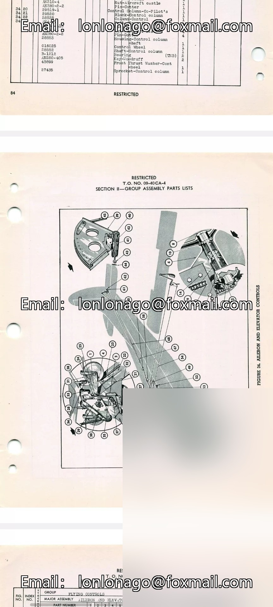
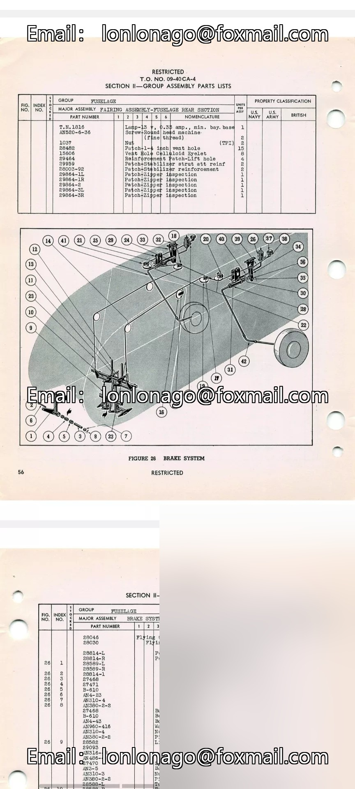
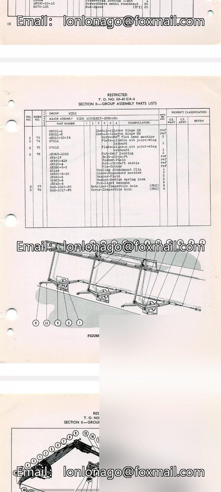
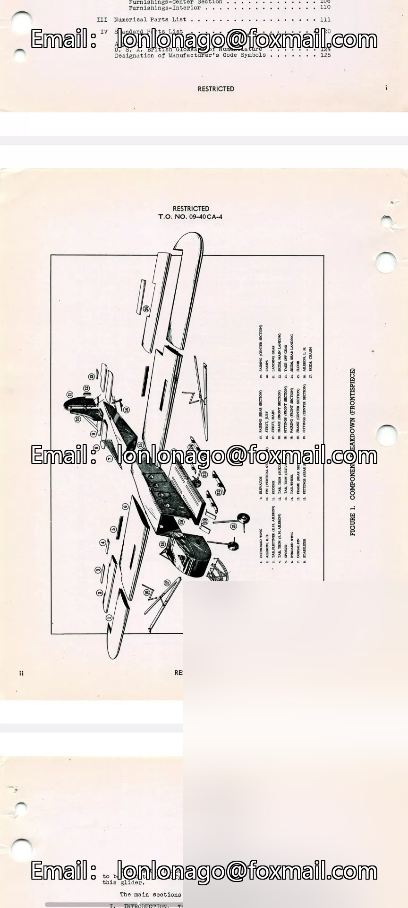
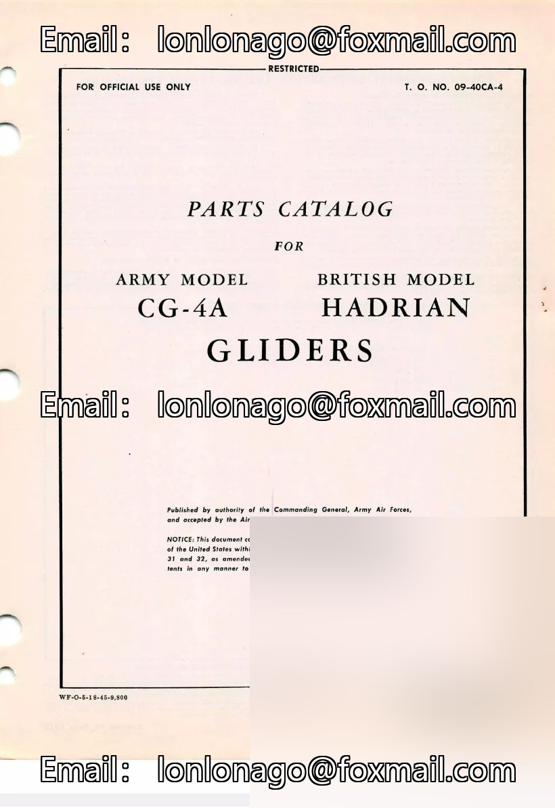

# 《Army model CG-4A, British model "Hadelion" glider parts catalog》Electronic

## Body

《Army Model CG-4A, UK Model "Hadley" Glider Parts Catalogue》
130 pages
1. Detailed parts list, including various components, structures, and numbering information for the CG-4A and "Hadley" Glider
2. Military history materials, suitable for reference by military enthusiasts, model making, and historical research
2. File format
PDF format, , can be copied
3. upon sale
Requires direct photography, contact privately for issues

The catalog includes parts lists for the Army model CG-4A and the British "Hadell" glider, covering components, structures and numbers; it is in PDF format, with some items requiring sale.

<!-- AI_ENRICHED -->

## Images

## Payment

Here is a pay link on Stripe ( https://buy.stripe.com/3cs8yP7sY87d0vu9AB ). Please contact me lonlonago@foxmail.com after funding $89, and I will send you a complete data files , thank you!

